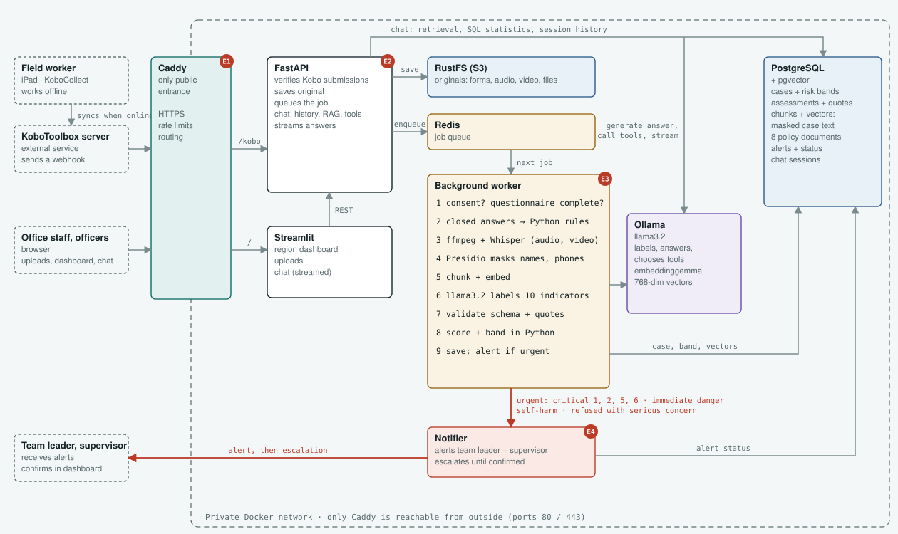

# AI CARE Assistant


## The Problem

Child protection organisations receive information about children through two channels: field rounds, where field workers interview children with a questionnaire on an Android device, and the office helpline, where calls are written up as reports and sometimes recorded. After a field round, staff transfer the answers into Excel sheets and analyse them by hand. This creates three problems:

- **Delay:** at-risk children are found only after the round ends and the spreadsheets are compiled. A child in danger can wait days or weeks before anyone acts.
- **Scattered information:** questionnaires, call reports, recordings and documents sit in different places and formats, so no one has a single view of a child's situation.
- **Lost continuity:** case knowledge often lives with individual field workers. When a worker leaves, the history of the children in their region can be lost.

## Description

AI CARE Assistant is an early-warning and case management system built for child protection organisations in Ghana. It receives children's cases from field interviews (KoboToolbox), helpline calls and office files, assesses each case against 10 risk indicators when it arrives, and alerts the team leader when a child may be in danger. Staff can then ask questions about the cases and the child protection laws and get answers with their sources.

The application is built in Python and the language models run locally through Ollama, so children's information never leaves the organisation. The model never decides on its own: it labels the indicators with quotes from the report, the labels are checked in Python, and the risk band is calculated in Python.

## Features

- Kobo webhook for field interviews (works with offline submissions)
- Helpline reports, recordings and office files (PDF, Word, Excel, video)
- Speech to text with Whisper
- Names and phone numbers masked before the model sees anything (Presidio)
- Risk assessment with a validated JSON output (Pydantic) and a quote check
- Risk band and urgent flags calculated in Python
- Alerts that escalate until someone confirms them
- Chat with tools, retrieval (RAG) and sources
- Region lock: a team leader only sees their own region
- Conversation memory in Postgres
- Streamed answers
- Dashboard, uploads and chat pages (Streamlit)
- Runs in Docker behind Caddy (HTTPS)

## Architecture



AI CARE Assistant follows this flow:

Kobo / Helpline / Uploads → Caddy → API → Redis queue → Worker → Ollama (local LLM) → Validation → Postgres → Alerts and Dashboard

- **Caddy:** the only public entrance. It gives HTTPS and sends each request to the API or the pages. Rate limits at Caddy, shown in the diagram, were in the original plan; they need a Caddy add-on (`caddy-ratelimit`), so they are listed as a future improvement.
- **API (FastAPI):** checks the request is genuine, saves the untouched original in RustFS (S3 storage), puts a job in the Redis queue and answers straight away.
- **Worker:** takes the job, reads the form answers with Python rules, transcribes recordings with Whisper, masks names, asks llama3.2 to label the indicators, checks the answer and saves the case.
- **Notifier:** sends alerts for urgent cases and escalates them until confirmed.
- **Postgres + pgvector:** stores the cases, alerts, chat memory and the searchable chunks with their vectors.
- **Ollama:** runs `llama3.2` (labels and answers) and `embeddinggemma` (vectors) locally, outside Docker.
- **Streamlit:** the dashboard, uploads and chat pages.

The model runs locally on the computer. The application state (cases, alerts and conversations) is kept in Postgres, not in the model.

## Technology Choices

| Part | Choice | Why |
|---|---|---|
| Field data collection | KoboToolbox | Already used by field teams; works offline on Android devices |
| Entrance | Caddy | Automatic HTTPS; the only public entrance |
| Backend | FastAPI | Typed models, automatic validation, streaming |
| Job queue | Redis | The API answers straight away while the worker does the slow model work |
| File store | RustFS (S3) | Keeps the untouched originals. MinIO's images are no longer published; any S3 store can replace it through `.env` |
| Database and vectors | Postgres + pgvector | Records and similarity search in one service, with region filtering |
| LLM | `llama3.2` through Ollama | Runs locally, so children's information never leaves the organisation; small enough for an office computer |
| Embeddings | `embeddinggemma` through Ollama | The balance between languages and hardware: supports the main international languages and runs on a CPU. Compared by reading with `nomic-embed-text` (mainly English) and `qwen3-embedding` (needs a GPU) |
| Speech to text | Whisper `small` (`faster-whisper`) + ffmpeg | 14.3% word error rate on English instead of 19.1% with `base`, and kept words that matter ("14-year-old", not "40-year-old") |
| Masking | Presidio + spaCy `en_core_web_lg` | Missed the child's name in 23 of 139 reports instead of 92 with the small model |
| Validation | Pydantic | Schema check of the model's output |
| Pages | Streamlit | Dashboard, uploads and chat in Python |
| Deployment | Docker Compose | Runs all services together the same way on any computer |

## Installation

### Requirements

- Git
- Docker and Docker Compose
- Ollama with `llama3.2` and `embeddinggemma`
- Python 3.11.16 and ffmpeg (to run without Docker)

### Environment

```bash
git clone https://github.com/Awenatey05/AI-CARE-Assistant.git
cd AI-CARE-Assistant
cp .env.example .env
```

Set your own values in `.env`. No credentials are in the code. These must be set before the first start:

| Setting | What it is |
|---|---|
| `POSTGRES_PASSWORD` | the database password (also inside `DATABASE_URL`) |
| `STORAGE_ACCESS_KEY`, `STORAGE_SECRET_KEY` | the file storage key and secret |
| `KOBO_WEBHOOK_SECRET` | the secret Kobo sends; without it, every submission is refused |
| `API_KEY` | the key the pages send to the API |

A long random value can be made with `python -c "import secrets; print(secrets.token_urlsafe(32))"`.

```bash
ollama pull llama3.2
ollama pull embeddinggemma
```

## Running the application

### With Docker

```bash
docker compose up -d --build
docker compose ps
```

Open **https://localhost**. The browser warns once about the certificate, because Caddy made it for `localhost`. `https://localhost/health` shows whether every service is reachable.

### Without Docker for the app

**Python environment.** Create and activate a virtual environment, then install the packages:

```bash
python3 -m venv .venv
source .venv/bin/activate
pip install -r requirements.txt
```

**Supporting services.** Start the database, queue and file storage:

```bash
docker compose up -d postgres redis rustfs
```

**Running the application.** The application has three parts, each run in its own terminal:

```bash
python worker.py
```
The worker: assesses each case from the queue, saves it and sends alerts.

```bash
uvicorn main:app --reload
```
The API: receives Kobo submissions, uploads and chat questions (http://localhost:8000/docs).

```bash
streamlit run streamlit_app.py
```
The pages: dashboard, uploads and chat (http://localhost:8501).

**Loading data.** To load some synthetic data and the policies:

```bash
python -m scripts.enqueue_data --field 20 --helpline 10 --uploads
python -m scripts.load_policies
```

`--all` loads all the synthetic data and takes about 3 hours; the small load above takes a few minutes.

Kobo's servers cannot reach a laptop on `localhost`, so the saved Kobo submissions are sent through the same intake as the webhook by `scripts.enqueue_data`.

**Chat in the terminal:**

```bash
python -m scripts.chat northern
```
`/history` shows the conversation, `/reset` starts a new one and `/exit` leaves.

## Tests

```bash
pytest
```

268 tests. The model and Whisper are replaced by fakes with fixed answers, so Ollama is not needed; tests that need Postgres, Redis or the storage are skipped if they are not running.

## System Prompts

The prompts are kept separately in `app/llm/prompts.py`. There are two main prompts:

- **The assessor (`SYSTEM_PROMPT`):** reads a closing report and labels each of the 10 indicators as present or not, with a word-for-word quote. It treats the report as data, not instructions, and marks anything unclear as not present.
- **The assistant (`ASSISTANT_PROMPT`):** answers staff questions. It is told the user's region and the tools it can use, replies with a JSON order for a tool or `{"ready": true}` when it has what it needs, and then writes the answer with sources. The last message before the answer (`ASSISTANT_USER_PROMPT`, a user message) repeats the current question, so the model answers the new question and not an earlier one, in plain text that can be streamed.

## Conversation Memory

Conversations are saved in Postgres (`chat_messages`), not in the model. With each question, the last 3 questions and answers are sent to the model, so follow-ups like "explain further" work. Questions are saved masked, so no child's name is stored.

In the chat page, each role and region keeps its own conversation; **Clear chat** and **Reset** start a new one. In the terminal (`python -m scripts.chat northern`), `/history` shows the conversation, `/reset` starts a new one and `/exit` leaves.

## RAG Design

Documents → masking → chunking → embeddings → pgvector → question → similarity search → relevant chunks → llama3.2 → answer with sources

- **Sources:** 8 child protection laws and policies (`data/policies/`, PDF) and every case's report. Only masked text is chunked: names appear as `[NAME]` and phone numbers as `[PHONE]`.
- **Chunking:** 120 words, each overlapping the one before by 25 words (`app/rag/rag.py`), so a sentence that falls on a cut is still whole in one chunk. Most case reports are shorter than 120 words and stay in one chunk. The policies give 1,263 chunks and the cases 1,189.
- **Embeddings:** `embeddinggemma`, 768 numbers per chunk, stored in Postgres with pgvector.
- **Search:** the question is compared with every chunk by cosine similarity in Postgres, and the 5 closest chunks are given to the model, however low their score: it is safer for the model to read a chunk that does not help than to hide one about a child at risk. A team leader searches only their own region's cases; the policies are always included.
- **Sources:** each chunk is named after its source (`NR-TML-GUM-0012-2026#chunk-0`, `policy_childrens_act_560.pdf#chunk-16`) and answers cite it in brackets. A citation that search did not return is removed.
- **Missing evidence:** when the chunks do not answer the question, the model says "I don't have enough evidence".
- **Counting:** search finds text that means something similar; it cannot count or list. "How many High cases?" is answered by the case tools.

**Why retrieval instead of every document in the prompt:** the policies alone are about 120,000 words and the cases grow every day, far beyond the model's context window. Retrieval sends only the relevant chunks, which keeps answers fast, makes it less likely that the model mixes up children, lets each answer cite its source, and applies the region filter before the model sees anything.

## Tools

The assistant decides when a tool is needed; Python checks the arguments before anything runs.

| Tool | What it does |
|---|---|
| `count_cases` | Counts cases by band, region, district or community. Numbers are never guessed by the model |
| `list_cases` | Lists cases, most serious first, with the supporting quote |
| `show_case` | Shows one case's saved assessment |
| `find_case_by_name` | Finds a case by a child's name, **only after the user says OK** |
| `search_documents` | Searches the region's reports and the 8 policies by meaning (RAG) |

## Structured Output and Validation

The model returns JSON for the 10 indicators, validated with Pydantic (`app/models/assessment.py`). Every quote must appear in the report. A wrong answer is retried once, then the case is marked **"could not assess"** for a person. The band is always calculated in Python.

## Error Handling

- Wrong or missing secret: refused (401)
- Malformed submission or empty question: refused (422)
- Storage or queue down: 503, so Kobo sends again later and nothing is lost
- Model unavailable or invalid answer: retried once, then "could not assess"; the Python rules still raise urgent alerts
- A job that crashes is kept in a failed list with its error, and the worker carries on
- A case that is not found: the assistant says so and never invents one

## Project Structure

```
AI-CARE-Assistant/
├── app/
│   ├── api/        routes: Kobo webhook, intake, alerts, cases, chat
│   ├── core/       database connection
│   ├── llm/        Ollama client and prompts
│   ├── models/     Pydantic schemas
│   ├── rag/        loaders, chunking, embeddings, search, answers
│   ├── services/   pipeline, assessment, masking, transcription, storage, queue, notifier
│   └── tools/      the assistant and its tools
├── data/           synthetic submissions, calls, recordings, uploads, policies, answer key
├── evaluation/     results and proof of each run
├── notebooks/      prompt comparison, asking questions
├── scripts/        data loading and evaluation
├── tests/          268 tests
├── main.py         the API
├── worker.py       the worker and notifier
├── streamlit_app.py
├── config.py
├── Dockerfile
├── docker-compose.yml
├── Caddyfile
├── .env.example
└── requirements.txt
```

## Prompt Experiment

Three variations of the assessor prompt (A: role and indicator names only; B: adds a meaning for each indicator; C: adds rules) were tested on the same 50 reports with the same model, then the system prompt was improved twice. A and B often broke the JSON format and C found only 10% of the real indicators; the final prompt finds 56%. Adding definitions only helped once the format rules were there.

## Evaluation

| Measure | Result |
|---|---|
| Risk band correct (held-out field cases) | 89% |
| Urgent alerts missed (held-out field cases) | 0 of 18 |
| Test cases passed | 12 of 14 |
| Search recall@5 / MRR | 0.91 / 0.86 |

The results are made by these scripts and saved in `evaluation/`:

```bash
python -m scripts.evaluate_assessment     # band, alerts and indicators against the answer key
python -m scripts.evaluate_test_cases     # the 14 test cases
python -m scripts.evaluate_retrieval      # recall@k, mean reciprocal rank, citation precision
```

## Limitations

The system supports decisions; it does not make them. Urgent cases, "could not assess" cases and incomplete questionnaires always go to a person.

- **Helpline calls and documents are the weak spot:** 32% of calls could not be assessed, and 4 of 17 urgent calls were missed.
- **Local languages:** Whisper does not support Dagbani or Twi.
- **False alarms:** physical violence and trafficking are often flagged on weak reasons, and each alert must be checked by a person.
- **Masking misses some local names,** especially names that are also English words (for example Comfort).
- **Videos are used for what is said, not what is shown.**
- **Alerts only appear on the dashboard;** there is no email or SMS yet.
- **No personal logins:** the role and region are chosen on the page.

All data in this repository is synthetic.

## Future Improvements

- A larger model (`qwen2.5`) as a second try when llama3.2 fails
- A speech model trained on Ghanaian languages, with a person checking those calls meanwhile
- Clearer indicator definitions, measured with the prompt experiment again
- A list of common Ghanaian names added to the name finder
- A vision model to flag visible signs in videos and photos (such as wounds) for an officer to review
- Email or SMS alerts
- Personal logins, with the role and region from the account
- Rate limits at Caddy
